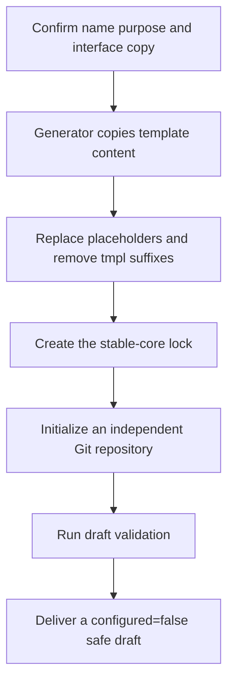

<div align="center">

<h1>AIALRA Skill Template</h1>

<p><strong>Create one independent, core-locked Codex Skill repository that cannot run real tasks until its domain workflow is verified</strong></p>

<p>
  <a href="CHANGELOG.md"></a>
  <a href="#repository-layers"></a>
  <a href="#safe-draft"></a>
  <a href="README.md"></a>
</p>

<p>
  <a href="#project-overview">Overview</a> ·
  <a href="#repository-layers">Repository layers</a> ·
  <a href="#create-repository">Create a repository</a> ·
  <a href="#safe-draft">Safe draft</a> ·
  <a href="docs/architecture.md">Architecture</a> ·
  <a href="SECURITY.md">Security</a>
</p>

<p><a href="README.md">简体中文</a> · <a href="README.en.md">English</a></p>

</div>

<a id="project-overview"></a>

## 1 Project overview

This repository is a Skill repository generator for first-time template users, new Skill maintainers, and reviewers of the runtime framework

Given a name, purpose, and interface copy, it creates a separate Git repository containing a Runner, schemas, validators, tests, security scanning, controlled learning, and a stable-core lock

The generated repository remains a safe draft and cannot run a real task until its domain workflow and tests are complete

<div align="center">

Table 1.1 Public template status

| Item | Current value |
|---|---|
| Current version | `0.11.2`, from [`VERSION`](VERSION) and [`CHANGELOG.md`](CHANGELOG.md) |
| Generation scope | One independent Skill repository per run |
| Default state | `definition.configured=false`, so the Runner rejects real tasks |
| Stable core | `.core-lock.json` stores SHA-256 digests |
| Validation entry points | Template validation, unit tests, and sensitive-data scanning |
| License | No repository-root license is provided, so public visibility does not automatically grant rights to copy, modify, redistribute, or use commercially |
| Documentation languages | Chinese primary README and English mirror |

</div>

<div align="center">



Figure 1.1 AIALRA Skill Template generation loop

</div>

## 2 Reading goals

This README answers two questions: what this repository is and how to create a first Skill repository

It is intended for:

- People seeing the template for the first time
- Maintainers preparing a new Skill
- Reviewers who want the overall structure before reading detailed references

After reading, you should be able to generate a safe draft repository and choose the next relevant document

You do not need to understand the Runner, schemas, validators, or state machines in advance because later documents introduce them individually

## 3 Repository positioning

The repository is a Skill repository generator

You provide the Skill name, purpose, and interface copy, and the generator creates a new independent Git repository with a runtime framework, tests, security checks, and learning boundaries

The result starts in a safe-draft state and does not run real tasks before domain workflow implementation and testing are complete

## 4 Skill composition

A Skill is a group of instructions and resources organized around one well-defined task

A typical Skill contains:

- Trigger guidance
- Execution steps
- Input and output rules
- Reusable scripts
- Result validators
- Security boundaries
- Tests

This template keeps one Skill in one repository so versions, permissions, tests, and rollback remain independent

<a id="repository-layers"></a>

## 5 Template and generated repositories

You work with two kinds of repository

<div align="center">

Table 5.1 Repository responsibility split

| Repository | Purpose | Maintainer |
|---|---|---|
| This template repository | Stores the shared generator and runtime | Template maintainer |
| A generated Skill repository | Stores one concrete Skill | Maintainer of that Skill |

</div>

The `template/` directory contains generation sources that become the new independent repository after placeholder processing

The generated Skill repository matches the processed structure of `template/`, not the entire template-factory repository

The generator performs these steps:

- First, copy files from `template/` to the new repository root

- Second, replace placeholders such as `__SKILL_NAME__` with confirmed values

- Third, remove the `.tmpl` suffix so `README.md.tmpl` becomes `README.md`

- Fourth, create `.core-lock.json` to detect stable-core drift immediately

- Fifth, initialize a new `.git/` so the Skill has independent commits, versions, remotes, and rollback history

<div align="center">

Table 5.2 Template-to-repository mapping

| Template-factory source | Generated result | Copied into the new repository |
|---|---|---|
| `template/README.md.tmpl` | `README.md` | Yes |
| `template/.agents/skills/__SKILL_NAME__/SKILL.md.tmpl` | `.agents/skills/<actual-name>/SKILL.md` | Yes |
| `template/.agents/skills/__SKILL_NAME__/workflow.yaml.tmpl` | `.agents/skills/<actual-name>/workflow.yaml` | Yes |
| Root `scripts/create_skill_repo.py` | No generated file | No, it is the factory generator |
| Root `docs/` | No generated directory | No, it documents the factory |
| Root `tests/test_template_runtime.py` | No generated file | No, it tests the factory |

</div>

The current repository therefore has two conceptual layers:

- Template-factory layer containing the root generator, documentation, and template tests
- Finished-Skill layer created by processing `template/` into an independent repository

### 5.1 Nested Git repository risk

The template repository and generated repository each own a `.git/` directory

The following structure is incorrect:

```text
AIALRA-SKILL-TEMPLATE/       # Outer template repository
└── example-skill/           # Incorrectly nested generated repository
    └── .git/                # Independent history of the inner Skill repository
```

This nested arrangement causes several problems:

- Outer `git status` does not show ordinary changes to every inner file because the inner repository becomes a separate boundary
- Outer `git add` may report `adding embedded git repository` and record only a gitlink to one inner commit
- Someone cloning only the outer repository may not receive the actual inner files
- Agents and scripts may select the wrong repository root for commits, tags, core locks, and remotes
- Moving, deleting, or rolling back the outer directory can remove unpushed inner commits

Place the repositories next to each other instead:

```text
workspace/                   # Parent working directory
├── AIALRA-SKILL-TEMPLATE/   # Template-factory repository
└── example-skill/           # Independent generated Skill repository
```

<a id="create-repository"></a>

## 6 Create the first Skill repository

### 6.1 Prepare five generation values

Confirm these values before generation:

- First, a stable Skill name containing lowercase letters, digits, and single hyphens, with a length from `1` through `64` characters, such as `example-research-skill`

- Second, a complete purpose description from `40` through `1024` characters that states both applicable requests and exclusions

- Third, a human-facing display name, which may use spaces and natural language, such as `Example Research Skill`

- Fourth, an interface short description from `25` through `64` characters

- Fifth, a default prompt that explicitly contains `$Skill-name` so Codex knows which Skill the user intends to invoke

These values can be discussed in a Codex task and confirmed before they are passed as command arguments

They do not need to be written into template files manually

<div align="center">

Table 6.1 Generated destinations for confirmed values

| Value | Main destination | Result |
|---|---|---|
| Skill name | Skill directory, `SKILL.md`, `workflow.yaml`, and UI metadata | Keeps directory, trigger, and workflow identity aligned |
| Complete purpose | Top-level `description` in `SKILL.md` | Lets Codex decide when to use and avoid the Skill |
| Display name | `agents/openai.yaml` and documentation title | Presents a readable name |
| Short description | `agents/openai.yaml` | Explains the Skill quickly in a list |
| Default prompt | `agents/openai.yaml` | Provides an editable example request |

</div>

### 6.2 Handle the remote repository

The five generation values do not include a GitHub repository address

`--output` chooses only a local directory, and the generator runs only `git init -b main`

It does not create a GitHub repository, reserve a remote name, configure `origin`, or push content

Use this remote sequence:

- First, confirm the Skill name and keep the local directory and remote repository names aligned when practical

- Second, if the name must be reserved, create an empty GitHub repository without a README, license, or `.gitignore`

- Third, generate the local Skill repository next to the template repository

- Fourth, complete human review and local validation before any production push

- Fifth, set the empty repository URL as `origin` in the generated repository

- Sixth, commit and push only the validated content so remote history begins with a qualified commit

GitHub tokens, passwords, and other authentication data are managed by Git or an authorized tool and must never appear in a generation command, README, Skill file, or remote URL

### 6.3 Run the generator

Run this from the template repository root:

```bash
skill_name="example-research-skill" # Set the stable program-facing Skill name
output_path="../example-research-skill" # Place the new repository next to the template repository
display_name="Example Research Skill" # Set the human-facing Codex name
short_description="Research a defined topic with checked evidence" # Set the interface summary
full_description="Research a defined topic with checked evidence. Use when the user requests evidence-based research. Do not use for purchasing, account changes, or unrelated tasks." # State triggers and exclusions
default_prompt='Use $example-research-skill to research this topic.' # Explicitly invoke this Skill in the default request
python3 scripts/create_skill_repo.py --name "$skill_name" --output "$output_path" --display-name "$display_name" --short-description "$short_description" --description "$full_description" --default-prompt "$default_prompt" # Generate the independent safe-draft repository
```

<div align="center">

Table 6.2 Generator argument reference

| Part | Definition | Purpose |
|---|---|---|
| `python3` | Python interpreter | Runs the generator |
| `scripts/create_skill_repo.py` | Generator in this repository | Reads arguments and creates a complete Skill repository |
| `--name` | Stable Skill name | Controls directory, trigger, and workflow identity |
| `--output` | Local output path | Controls where the new repository is created |
| `--display-name` | Interface display name | Writes UI metadata and documentation titles |
| `--short-description` | Interface short description | Helps users identify the Skill |
| `--description` | Complete trigger description | Writes usage and exclusion scope to `SKILL.md` |
| `--default-prompt` | Default invocation prompt | Explicitly refers to `$example-research-skill` |
| Quotes | Argument boundary | Keeps spaces and `$` inside one argument |

</div>

Replace every example value with the real Skill information

When the name changes, update `--name`, `--output`, and `$example-research-skill` in the default prompt together

The optional `--portable` argument is reserved for isolated testing or environments where the official initializer cannot be used and is not part of normal production generation

### 6.4 Confirm the generated result

A successful command returns an object like this:

```jsonc
// These fields identify the completed generation and initializer route
{
  "created": true,
  "repository": "/local/absolute/path/example-research-skill",
  "skill": "example-research-skill",
  "initializer": "official initializer: /initializer/path"
}
```

`created=true` means generation, draft validation, core-lock creation, and local Git initialization all completed

`repository` is the absolute local path of the new repository

`skill` is the final stable name used by the generator

`initializer` identifies the official initializer or the portable initializer used for isolated tests

Invalid arguments, an existing output directory, failed draft validation, or failed Git initialization return `ERROR` and stop

The generator works in a temporary directory first, removes temporary content after failure, and never overwrites an existing target directory

The new directory contains these main entries, where text after `#` explains the entry and is not part of the filename:

```text
example-research-skill/                         # Independent repository root
├── .git/                                       # Commits branches and remotes for this Skill
├── .agents/skills/example-research-skill/      # Main discoverable Skill directory
│   ├── agents/openai.yaml                      # Codex interface metadata
│   ├── schemas/                                # JSON structures for entry and results
│   ├── scripts/                                # Runner validation learning and core-lock programs
│   ├── SKILL.md                                # Trigger guidance and Agent runtime protocol
│   └── workflow.yaml                           # Nodes order executors and failure paths
├── .github/                                    # GitHub Actions and dependency configuration
├── learning/                                   # Redacted events active rules archives and promotion proposals
├── scripts/                                    # Repository validation and sensitive-data scan entry points
├── tests/                                      # Runtime foundation and future domain tests
├── .core-lock.json                             # SHA-256 digests for stable-core files
├── .gitleaks.toml                              # Gitleaks sensitive-data configuration
├── .gitignore                                  # Local and runtime files excluded from Git
├── .pre-commit-config.yaml                     # Optional pre-commit validation
├── AGENTS.md                                   # Maintenance and runtime rules for Agents
├── CHANGELOG.md                                # User-visible version changes
├── README.md                                   # Configuration runtime and audit guide
├── SECURITY.md                                 # Credential confirmation and incident boundaries
└── VERSION                                     # Independent Skill version
```

The generator also initializes an independent Git repository and creates the first stable-core lock

<a id="safe-draft"></a>

## 7 Safe-draft state

The generated `workflow.yaml` contains:

```jsonc
// This flag keeps a new domain workflow disabled
{
  "definition": {
    "configured": false
  }
}
```

`false` means the domain flow is incomplete and the Runner refuses to start a real task

Complete these items before changing it to `true`:

- First, define supported and excluded requests in `SKILL.md`

- Second, replace the single generic draft node with the complete domain workflow

- Third, define Runner-checkable schemas for entry, node results, and final results

- Fourth, assign each node a fixed `script`, `mcp`, `browser-dom`, `computer-use`, or `reasoning` executor and declare side effects and confirmation requirements

- Fifth, add success and failure tests covering valid requests, invalid input, unauthorized actions, adjacent non-trigger requests, and two simultaneous first starts when a shared runtime is used

- Sixth, complete security checks for credentials, personal information, and user confirmation before external writes

- Seventh, set `definition.configured=true` only after the domain workflow and tests are complete

- Eighth, update the version and regenerate the stable-core lock to record the new stable behavior and SHA-256 digests

Before defining collection nodes, investigate official interfaces, connected tools, mature MCP servers, command-line interfaces, and existing Skills

Adopt a backend only after reviewing license, permissions, maintenance, tests, outputs, and dependency safety

A mature backend does not replace the current Skill's multi-round coverage, stable deduplication, detail verification, stopping conditions, or result validation

The README generated inside the new repository introduces these operations progressively

## 8 Built-in template constraints

- The Runner owns node order and state transitions, so an Agent cannot skip steps or declare completion on its own
- Schemas reject missing fields, incorrect types, and unexpected properties before the next node
- Validators enforce deterministic cross-field and result rules that schemas cannot express
- Retries, fallbacks, and timeouts are bounded and follow declared paths
- External writes and destructive operations pause for explicit user confirmation
- A SHA-256 manifest hard-stops stable-core drift in workflows, schemas, or runtime code
- Learning writes only to `learning/`, creates proposals, and cannot modify stable workflows or permissions automatically
- Sensitive-data scanning runs locally and in continuous integration over current files and complete Git history

The reading route introduces unfamiliar names only when they become relevant

## 9 Template responsibility boundary

The template creates the runtime framework and mandatory checks

The maintainer of a concrete Skill still defines:

- Real task scope
- Domain workflow
- Tools and permissions
- Input and output schemas
- Domain tests
- Result-quality requirements

The user personally completes authentication, CAPTCHA, QR scanning, and two-factor authentication

Real credentials and browser sessions must never be committed to Git

## 10 Documentation route

Choose one document for the current goal

<div align="center">

Table 10.1 Next-document routing

| Goal | Next document |
|---|---|
| Understand how one request runs | [Architecture introduction](docs/architecture.md) |
| Fill in `workflow.yaml` | [Workflow exact reference](docs/workflow-reference.md) |
| Build repeatable collection or reuse a mature tool | [Repeatable collection and mature backend reuse](docs/repeatable-collection.md) |
| Understand every file | [File map](docs/file-map.md) |
| Understand controlled experience accumulation | [Controlled learning](docs/learning.md) |
| Upgrade or release a version | [Versioning and maintenance](docs/maintenance.md) |
| Modify this template | [Contributing](CONTRIBUTING.md) |
| Handle permissions and sensitive information | [Security policy](SECURITY.md) |
| Migrate from version `0.1` | [Version 0.2 migration guide](docs/migration-v0.2.md) |
| Review design evidence | [Research notes](docs/research-notes.md) |

</div>

For a first reading, open only the document that matches the immediate goal

## 11 Template repository validation

Template maintainers run these commands after changing this repository:

```bash
python3 scripts/validate_template.py # Check template structure generated output and core contracts
python3 -m unittest discover -s tests -v # Run template runtime and generated-repository regression tests
python3 scripts/check_secrets.py # Scan current files and Git history for suspected sensitive data
```

[Contributing](CONTRIBUTING.md) explains the purpose, operator, prerequisites, expected success output, and failure handling for each command
