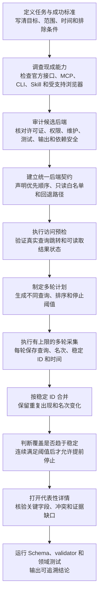

# 可重复采集与成熟后端复用

## 这份文件能帮你做什么

这份文件用于设计结果会变化的外部研究 Skill

常见任务包括查找当前信息、汇总多个页面、比较候选和核验详情

读完以后，你应该能够回答四个问题

1. 为什么单次查询不能直接形成结论
2. 怎样执行有上限的多轮采集
3. 怎样优先复用成熟工具
4. 怎样证明结果稳定、可追溯并且没有越权

本页只提供一个通用方法

具体 Skill 根据自身领域填写查询、稳定 ID、详情字段和风险规则

## 先看完整流程



## 哪些任务需要多轮采集

以下任一情况成立时，应当考虑多轮采集

- 同一查询在不同时间会返回不同结果
- 不同关键词会命中不同表达方式
- 排序、地区、时间或筛选条件会改变候选
- 搜索卡片的信息不足以判断真实内容
- 需要证明最低值、最高值、覆盖度或代表性
- 需要区分偶然结果和重复出现的稳定结果

结果稳定、来源唯一且接口能够一次返回完整数据时，可以使用单轮

是否多轮由领域事实决定，不由模板强制统一

## 第一原则：先调查现成能力

创建采集代码以前，按照以下顺序调查

1. 官方接口 —— 权限、字段和使用条款通常最清楚
2. 已连接的专用工具 —— 已经完成认证和结构化输出时优先使用
3. 成熟 MCP 或 CLI —— 适合复用已经维护的页面或协议适配
4. 成熟 Skill —— 适合学习触发条件、工作流、Schema 和安全边界
5. 受支持浏览器 —— 在没有合适结构化能力时读取当前登录页面
6. 自行实现 —— 只有前面路径无法满足需求时才编写新采集器

顺序表示调查优先级

最终选择仍由许可证、权限、可靠性、可维护性和任务适配度共同决定

## 什么叫成熟后端

成熟不等于星标多

候选后端至少需要检查以下项目

| 检查项 | 要确认什么 | 不满足时怎样处理 |
|---|---|---|
| 许可证 | 是否允许复制、修改、分发和当前使用方式 | 没有明确许可证的项目只能学习公开思路，不能复制代码 |
| 维护状态 | 最近是否维护，接口变化后是否有人处理 | 长期停止维护时只作为参考或备用 |
| 权限范围 | 能读取什么，能写入什么，是否接触凭据 | 权限超过任务需要时不能自动安装或默认启用 |
| 动作范围 | 能否只开放工作流需要的动作 | 不能限制写入动作时不作为默认后端 |
| 输出结构 | 能否稳定转换为当前节点输出 Schema | 不能映射时需要适配层或放弃 |
| 测试 | 是否存在测试，测试是否覆盖准备使用的动作 | 没有测试时必须补充本地契约测试 |
| 依赖安全 | 当前依赖是否存在已知高风险漏洞 | 先升级、隔离或停用受影响路径 |
| 登录边界 | 是否复用用户授权会话，是否导出凭据 | 要求导出凭据时拒绝采用 |
| 失败行为 | 登录、验证码、限流和页面变化怎样报告 | 无法区分失败原因时需要适配层 |
| 回退路径 | 后端不可用时能否换用另一条受支持路径 | 没有回退时必须向用户明确单点风险 |

审计结论必须写入具体 Skill 的 `references/`

通用模板不保存平台目录或项目清单

## Skill 和采集后端各自负责什么

### Skill 负责稳定规则

- 什么时候触发
- 用户目标怎样转换为研究计划
- 最少和最多执行多少轮
- 怎样按稳定 ID 去重
- 什么时候判定覆盖趋于稳定
- 哪些候选需要详情核验
- 结果怎样分级和排序
- 哪些情况必须等待用户或停止
- 输出必须包含哪些证据

### 后端负责读取当前数据

- 执行查询和受支持筛选
- 读取当前页面或接口字段
- 返回稳定 ID、直接链接和采集时间
- 打开指定详情并读取允许字段
- 报告登录、验证码、权限、限流和结构变化

后端不能自行跳过节点、改变停止规则或宣布最终结论

## 为什么需要访问预检

打开首页只证明网络和入口可达

它不能证明以下能力已经可用

- 查询能够真正提交
- 查询后能够进入结果状态
- 结果卡片能够读取
- 详情链接能够打开
- 当前登录状态仍然有效
- 第二轮查询不会立即触发限流或人机检查

结果会变化的外部研究 Skill 应当在正式采集前完成一次访问预检

预检至少使用目标查询执行一次真实跳转，并记录后端、目标站点、登录状态、可见结果状态和带时区的检查时间

预检可以作为独立外部节点，也可以作为采集节点的第一个固定阶段

独立节点更适合需要清楚区分访问失败与采集失败的 Skill

## 访问状态怎样分类

| 状态 | 人话含义 | 处理方式 |
|---|---|---|
| `results-visible` | 查询已经进入结果页并看到可读取结果 | 可以继续多轮采集 |
| `no-results-visible` | 页面明确显示目标查询没有结果 | 可以继续形成可验证的空结果 |
| 登录失效 | 页面要求用户重新登录或扫码 | 使用 `user-required` 并等待用户 |
| 人机检查 | 页面要求验证码或机器人确认 | 使用 `user-required` 并等待用户，不自动处理 |
| 临时限流 | 页面明确表示请求过多或暂时失败 | 在节点预算内使用 `retryable` |
| 不支持的页面表面 | 只能打开首页、企业官网、空白页或无法完成真实搜索 | 使用 `fallback` 或结束本次后端 |
| 宿主策略阻止 | 宿主明确禁止当前页面或动作 | 使用 `policy-blocked` 且不得换工具绕过 |
| 凭据读取要求 | 页面或工具要求 Cookie、本地存储、设备指纹或浏览器配置 | 使用 `fatal` |

同一后端第一轮成功、第二轮出现人机检查时，后一次真实状态优先

第一轮数据可以保留为部分证据，不能继续声明后端稳定或研究完成

搜索页和详情页可能使用不同读取技术

只要它们属于同一个经过预检的允许后端，并且返回相同 Schema，就不需要把读取技术差异伪装成新的数据来源

## 怎样声明后端路由

外部节点可以在 `action.arguments` 中声明一个 `source_routing` 大分类

下面是结构示例

```jsonc
{
  "action": {
    "name": "domain.collect-search-rounds",
    "arguments": {
      "source_routing": {
        "provider_order": [
          "preferred-mcp",
          "trusted-cli"
        ],
        "providers": {
          "preferred-mcp": {
            "kind": "mcp",
            "identifier": "example-mcp-server",
            "availability": "installed-and-loaded",
            "allowed_operations": [
              "domain.search"
            ],
            "prohibited_operation_classes": [
              "account-write",
              "credential-read"
            ],
            "evidence_contract": {
              "node_output_schema": "current-node-output",
              "observation_schema": "provider-observation-v1"
            }
          },
          "trusted-cli": {
            "kind": "cli",
            "identifier": "example-cli",
            "availability": "installed-connected-and-trusted",
            "allowed_operations": [
              "domain.search"
            ],
            "prohibited_operation_classes": [
              "account-write",
              "credential-read"
            ],
            "evidence_contract": {
              "node_output_schema": "current-node-output",
              "observation_schema": null
            }
          }
        },
        "selection_policy": {
          "select_before_first_access": true,
          "reuse_selected_after_success": true,
          "switch_only_when_unavailable_before_access": true,
          "hard_stop_kinds": [
            "user-required",
            "policy-blocked",
            "fatal"
          ]
        }
      },
      "collection_policy": {
        "minimum_rounds": 3,
        "maximum_rounds": 8,
        "candidate_limit": 100
      },
      "safety_policy": {
        "read_only": true,
        "minimum_action_interval_seconds": 3,
        "maximum_parallel_pages": 1,
        "challenge_retries": 0,
        "reuse_observation_cache_seconds": 900
      }
    }
  }
}
```

`provider_order` 表示选择顺序

`providers` 保存每个后端的类型、准确标识、可用条件、动作边界和证据契约

`selection_policy` 保存所有后端共同遵守的选择和停止规则

Runtime 会拒绝直接散落在 `source_routing` 下的后端条目

后端不可用时可以进入下一项

登录、验证码、宿主策略和授权不足需要报告真实状态，不能通过换后端绕过

后端应当在访问预检前选择

预检通过后，当前运行保持使用该后端

登录失效、人机检查、授权不足和策略阻止不能成为运行中静默换源的理由

某个候选后端在预检以前已经确认未安装、未连接或不受支持时，可以按 `provider_order` 选择下一项

## 为什么后端路由不改变工作流节点

工作流节点描述任务阶段

采集后端描述完成该阶段的具体读取方式

把两者分开后，更换采集工具不会改变多轮去重、详情核验和最终质量标准

节点的 `input_schema` 和 `output_schema` 是所有后端共同遵守的接口

具体 Skill 可以在输出中增加 `source_backend`，用于记录每条证据来自哪个后端

## 多轮采集放在哪里

Workflow IR 不允许图环路

同一个查询节点也不能通过 `on_success` 指回自己

多轮采集放在一个有上限的外部节点内部

该节点一次接收完整计划，一次返回全部轮次


这种结构保留无环工作流

轮次上限、候选上限和总时限仍然由计划与节点共同约束

## 一份多轮计划需要什么

最小计划包含以下内容

| 内容 | 用途 |
|---|---|
| 查询变体 | 覆盖正式名称、常见别名、条件和反例 |
| 排序或筛选组合 | 降低单一默认排序带来的偏差 |
| 最少轮次 | 防止第一轮结果被直接当成完整结果 |
| 最多轮次 | 防止无限搜索 |
| 每轮页数或结果上限 | 控制单轮预算 |
| 总候选上限 | 控制内存、详情数量和运行时间 |
| 稳定 ID 规则 | 判断两条记录是否属于同一对象 |
| 饱和阈值 | 判断新增结果是否已经持续降低 |
| 详情数量 | 限制需要深度核验的候选 |
| 节奏限制 | 控制并发和相邻动作间隔 |

查询变体需要有真实区别

只改变空格、大小写或无意义词序不能算新一轮

## 每轮必须保存什么

每轮至少保存以下字段

- `round_id` —— 当前轮次的唯一编号
- `query` —— 本轮使用的完整查询
- `sort_mode` —— 本轮使用的排序或筛选
- `retrieved_at` —— 带时区的采集时间
- `result_count` —— 本轮实际取得的结果数量
- `source_backend` —— 可选字段，记录实际采集后端

每条候选至少保存以下字段

- 稳定 ID
- 所属轮次
- 查询和排序
- 当前可见名次
- 当前直接链接
- 当前可见关键字段
- 采集时间

无法获得稳定 ID 时，需要先定义可靠的复合键

复合键不稳定时不能声称完成跨轮去重

## 怎样合并重复结果

同一稳定 ID 在多轮出现时只保留一个候选

同时保留以下历史

- `seen_in_rounds` —— 出现过的轮次
- `matched_queries` —— 命中过的查询
- `rank_history` —— 每轮可见名次
- `source_backends` —— 使用过的采集后端
- `first_seen_at` —— 第一次观察时间
- `last_seen_at` —— 最后一次观察时间

重复出现描述稳定性

重复记录不能增加唯一候选数量

不同轮次字段冲突时保留冲突，不静默覆盖

## 怎样判断覆盖趋于稳定

每轮结束后计算首次出现的唯一候选数量

例如三轮新增数量为 `[30, 8, 1]`

一轮新增很少不能直接停止

只有连续达到计划声明的低新增阈值，才允许使用 `saturated`

示例规则

```json
{
  "saturation": {
    "min_new_unique_per_round": 2,
    "consecutive_rounds": 2
  }
}
```

这表示连续两轮新增唯一候选都小于 2 时，才允许因趋于稳定提前停止

`saturated` 只表示当前计划继续搜索的新增收益较低

它不表示外部系统中不存在其他结果

达到最大轮次、候选上限或总时限时使用对应停止原因，不伪装成饱和

## 为什么还要打开详情

搜索卡片通常只提供摘要

摘要可能缺少条件、费用、时间、对象身份或限制

详情核验至少完成以下工作

1. 确认候选确实属于目标对象
2. 读取形成结论所需的关键字段
3. 比较卡片与详情是否冲突
4. 记录失败页面和缺失字段
5. 保存直接链接和采集时间

最低值、最高值、可行性和事实性结论不能只依赖未核验摘要

## 商品身份怎样避免误判

商品类研究可以在领域计划 Schema 中使用以下四组字段

```jsonc
{
  "product": {
    "canonical_query": "Model Alpha 16", // 给人阅读的目标名称
    "identity_phrases": [ // 标题至少连续命中一个型号写法
      "Model Alpha 16",
      "ModelAlpha 16"
    ],
    "required_terms": [ // 标题必须逐项包含的身份词
      "Alpha",
      "16"
    ],
    "excluded_terms": [ // 命中后直接排除的非目标内容
      "case only",
      "repair service"
    ]
  }
}
```

`canonical_query` 用于展示目标名称，不单独承担机器过滤

`identity_phrases` 是一至五个短而连续的型号写法，标题至少命中其中一个

`required_terms` 是原子身份检查，标题必须包含全部条目

`excluded_terms` 保存配件、服务、空包装、坏件和其他明确排除条件

候选进入详情前必须同时满足一个连续型号写法和全部原子身份词

这条组合规则可以阻止品牌、型号和规格词散落在无关标题中时被误认成完整目标商品

领域测试至少覆盖同品牌错误型号、身份词散落、带目标词的配件和完整目标商品四类案例

## 价格证据怎样绑定到当前候选

详情价必须来自已经确认标题和规格的同一主要商品区域

礼品卡金额、优惠券可省金额、划线价、历史价、相关商品价、订阅优惠和会员优惠不能自动充当当前商品公开价

条件价格需要单独保存条件类型、资格是否核验和优惠是否核验

详情价明显低于搜索卡片价时，validator 应要求已经核验的折扣证据

税费、运费和进口费用未知时，最终状态使用部分完成，并明确当前只能比较已知金额

## 图片证据怎样避免收进页面资源

详情快照没有直接图片地址时，工作流可以声明经过测试的只读网络请求操作

该操作必须出现在当前节点的动作白名单和 `source_routing.providers` 中

图片规则建议放入节点的 `action.arguments.image_evidence`

```jsonc
{
  "image_evidence": {
    "operation": "browser_network_requests", // 工作流允许调用的只读动作
    "allowed_host": "media.example.invalid", // 只接受经过测试的图片主机
    "allowed_path_prefix": "/product/", // 只接受商品媒体路径
    "allowed_file_extensions": [".jpg", ".png", ".webp"], // 只接受图片扩展名
    "maximum_urls_per_offer": 6 // 单个候选最多保存六张图
  }
}
```

validator 需要同时检查协议、主机、路径、扩展名、数量和当前候选关联

CSS、JavaScript、字体、导航图标、保修图、装饰图和其他页面资源不能提升商品证据等级

临时采集脚本中使用过的外部动作必须回写正式工作流、动作白名单、validator 和回归测试

## 合规节奏怎样写

节奏限制用于控制请求压力和误操作

它不能用于伪装设备、规避验证或绕过平台限制

具体 Skill 至少声明

- 最大并行页面数量，面向登录态消费平台的默认值为 `1`
- 相邻自动动作最短间隔，面向登录态消费平台的默认值不小于 `3` 秒
- 单轮和总候选上限
- 同一运行中的查询和详情缓存时间，重复证据优先复用且不重复访问
- 登录、人机检查、限流和策略阻止的重试次数，其中登录、人机检查和策略阻止必须为 `0`
- 真实搜索跳转预检
- 搜索页与详情页各自需要验证的能力
- 登录与验证码停止条件
- 禁止的凭据读取和账户写入
- 宿主策略禁止后的报告方式

出现登录、扫码、验证码或权限请求时进入 `user-required`

宿主策略明确禁止动作时使用 `policy-blocked`

页面或工具要求扩大权限时停止

低流量设置只能减少访问压力

它不能保证平台永远不触发登录校验、人机检查或限流

## 测试需要证明什么

多轮研究 Skill 至少需要以下测试

| 测试 | 证明什么 |
|---|---|
| 多轮成功路径 | 计划、采集、合并、详情和结论能够完整推进 |
| 真实搜索跳转 | 打开首页不能冒充已经通过访问预检 |
| 空结果状态 | 明确无结果页面能够形成可验证的空结果 |
| 登录状态失效 | 上次已经登录不能替代本次预检 |
| 第二轮挑战 | 第一轮成功后出现人机检查时不能继续声明稳定 |
| 不支持的页面表面 | 企业官网、空白页或无搜索跳转会被正确拒绝 |
| 查询多样性 | 重复或无意义变体会被拒绝 |
| 稳定 ID 去重 | 同一对象跨轮只计一次 |
| 重复历史保留 | 出现轮次和名次变化不会丢失 |
| 虚假饱和拒绝 | 新增量仍高时不能报告趋于稳定 |
| 上限停止 | 最大轮次、候选或时间达到后能够结束采集 |
| 详情核验 | 摘要不能直接冒充已核验结果 |
| 后端契约一致 | 每个受支持后端都能产生相同 Schema |
| 后端回退 | 首选后端不可用时进入声明的下一路径 |
| 登录停机 | 登录或验证码出现时等待用户 |
| 策略阻止 | 宿主禁止动作时不会寻找规避路径 |
| 只读白名单 | 写入和凭据动作永远不能调用 |
| 来源追溯 | 最终结论可以反向找到稳定 ID、链接和时间 |
| 敏感信息 | 仓库和学习数据不保存凭据与私人内容 |

### 使用共享运行时的额外测试

共享运行时是由多个任务复用的长期进程或本地服务

冷启动表示它当前没有运行，第一个任务需要先把它启动

只有 Skill 使用共享运行时时，才需要下面四项测试

| 测试 | 证明什么 |
|---|---|
| 单任务冷启动 | 一个任务可以从完全停止状态启动运行时并完成读取 |
| 两个任务同时冷启动 | 两个独立客户端同时启动时只有一个负责创建运行时，另一个会正常等待 |
| 已有运行时并发连接 | 运行时已经可用时，多个客户端都能连接且不会出现占用冲突 |
| 启动者退出 | 最先启动运行时的任务结束后，其他任务的连接和登录资料不会被误删 |

顺序启动的两个客户端不能替代同时冷启动测试

测试应使用全新的临时运行目录，避免旧进程和旧缓存掩盖首次启动缺陷

只有模拟测试通过仍然不够

涉及真实页面或外部接口时，还需要一次受控的真实只读验证

真实验证记录数量、字段覆盖、失败原因和页面变化

真实验证至少完成一次搜索跳转和一次详情读取

只验证首页加载不能证明 Skill 已经可用

不要把登录信息、完整工具输出或未脱敏数据提交到 Git

## 一次人工审计的顺序

按照以下顺序阅读具体 Skill

1. `SKILL.md` —— 确认触发范围、只读边界和完成标准
2. `references/provider-routing.md` —— 确认现成后端调查与选择依据
3. `workflow.yaml` —— 确认节点、后端顺序、轮次和停止条件
4. 计划 Schema —— 确认查询和预算有上限
5. 多轮结果 Schema —— 确认稳定 ID、轮次和时间被保存
6. 合并脚本 —— 确认重复结果只计一次
7. 详情 Schema 与 validator —— 确认摘要不能冒充详情证据
8. 最终 Schema 与 validator —— 确认结论能够反向追溯
9. 测试 —— 确认成功、失败、越权和回退都被覆盖
10. 安全文档 —— 确认凭据、验证码和第三方权限边界

读完后能够解释每一轮为什么存在、为什么停止、结论来自哪里时，审计才算完成

## 配置完成检查表

- 已经调查官方接口、现成工具和成熟项目
- 已经记录候选项目的许可证、权限、维护、测试和依赖安全
- 已经定义后端优先顺序和回退路径
- 已经为每个后端设置最小读取动作白名单
- 已经拒绝自动安装未获用户信任的高权限组件
- 已经用目标查询验证真实搜索跳转
- 已经分别验证搜索结果与详情读取能力
- 已经区分明确空结果、不支持页面表面和临时限流
- 已经规定预检通过后不能因登录、人机检查或策略阻止静默换源
- 已经定义真实不同的查询变体
- 已经设置最少轮次、最多轮次和候选上限
- 已经定义稳定 ID 或可靠复合键
- 已经定义连续饱和规则
- 已经保留轮次、名次、链接和采集时间
- 已经通过详情页核验关键结论
- 已经区分登录、验证码、策略阻止、可重试失败和致命失败
- 已经覆盖多轮、回退、越权和来源追溯测试
- 使用共享运行时时，已经覆盖单任务冷启动、两个任务同时冷启动、已有运行时并发连接和启动者退出
- 已经完成受控真实只读验证
- 已经通过核心锁和敏感信息检查

全部项目都有证据后，才能把 `definition.configured` 改为 `true`
